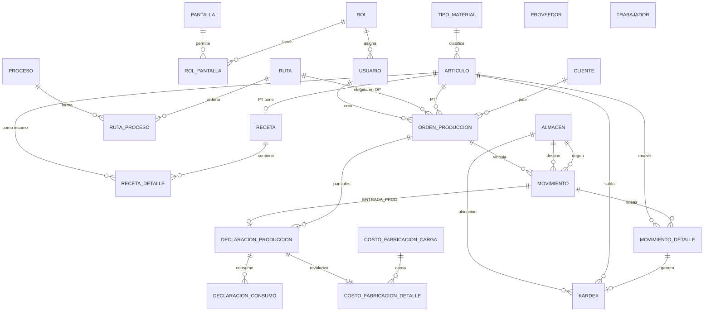

# Shaping — Software de Producción (prototipo)

Respetando `01-DEFINE-GOAL.md` (sección Decisiones prevalece).

---

## 1) Stack recomendado

**Django 5 + Django Templates + SQLite (demo) / PostgreSQL (después)**

| Pieza | Elección | Por qué |
|-------|----------|---------|
| Framework | Django | Auth, ORM, admin y formularios listos; ideal para maestros y reportes en local |
| Front | Templates + HTMX (opcional) | Sin SPA: demo rápida en laptop, sin build Node |
| BD demo | SQLite | Un solo archivo, cero instalación, portable en la laptop |
| BD prod | PostgreSQL | Cuando crezcan movimientos / concurrencia |
| Auth | Django auth + modelo Rol propio | Multiusuario + roles → pantallas |
| Deploy demo | `runserver` local | Presentación desde la laptop |

Alternativa descartada para la demo: FastAPI + React (más tiempo de front y auth). Fuera de alcance ahora: Vercel / Supabase (eso fue del software de mantenimiento).

---

## 2) Modelo de datos

Convenciones: PK `id` (bigint auto). Montos en `decimal(14,4)`, cantidades `decimal(14,4)`, fechas `date`/`datetime`. Soft-delete opcional vía `activo`.

### Auth y permisos
| Tabla | Columnas | Reglas |
|-------|----------|--------|
| **rol** | id, codigo, nombre, activo | Catálogo de roles |
| **pantalla** | id, codigo, nombre, modulo | Catálogo fijo de pantallas (seed) |
| **rol_pantalla** | id, rol_id FK→rol, pantalla_id FK→pantalla | Unique(rol, pantalla). Define qué ve/usa el rol |
| **usuario** | id, username unique, password_hash, nombres, email, rol_id FK→rol, activo, created_at | Login; un rol por usuario |

### Maestros
| Tabla | Columnas | Reglas |
|-------|----------|--------|
| **tipo_material** | id, codigo, nombre | **Fija, no editable** (seed): MP, AUX, REP, ENV, DESP, PT |
| **articulo** | id, codigo unique, descripcion, tipo_material_id FK, unidad_medida (kg/m/und/cono…), activo | Tipo desde tabla fija |
| **cliente** | id, codigo, ruc_documento, razon_social, direccion, telefono, activo | Tabla propia (no mezclar con proveedor) |
| **proveedor** | id, codigo, ruc_documento, razon_social, direccion, telefono, activo | Tabla propia |
| **trabajador** | id, codigo unique, nombres, tipo_documento (DNI/PASAPORTE/OTROS), numero_documento, activo | |
| **almacen** | id, codigo unique, nombre, es_proceso bool default false, activo | Si `es_proceso=true` solo en salidas/entradas de producción. El usuario crea N almacenes de proceso |
| **proceso** | id, codigo unique, nombre, activo | Tejido, teñido, corte… |
| **ruta** | id, codigo unique, nombre, activo | **Independiente del producto**; se elige en la OP |
| **ruta_proceso** | id, ruta_id FK, proceso_id FK, secuencia int | Unique(ruta, secuencia). Orden de la hoja de ruta |

### Receta (lista de materiales del PT)
| Tabla | Columnas | Reglas |
|-------|----------|--------|
| **receta** | id, articulo_pt_id FK→articulo (tipo=PT), lote_base decimal, activo, unique(articulo_pt) | Receta por lote base (ej. 100 und) |
| **receta_detalle** | id, receta_id FK, articulo_insumo_id FK→articulo, cantidad_por_lote decimal | Insumos del maestro. Escala OP: `cant_OP / lote_base × cantidad_por_lote` |

### Orden de producción
| Tabla | Columnas | Reglas |
|-------|----------|--------|
| **orden_produccion** | id, numero unique, cliente_id FK, articulo_pt_id FK, cantidad decimal, fecha_registro date, ruta_id FK, estado (ABIERTA/CERRADA), created_by FK→usuario, created_at | Ruta elegida al crear (no viene del PT). Admite entradas parciales hasta cierre |
| **op_costo_fabricacion** *(opcional auxiliar)* | — | El costo de fabricación **no** se carga en la OP al vuelo: se carga masivo a fin de mes **por declaración** (ver abajo) |

### Movimientos de almacén + Kardex
| Tabla | Columnas | Reglas |
|-------|----------|--------|
| **movimiento** | id, numero_transaccion unique, tipo (INGRESO/SALIDA/TRANSFERENCIA/SALIDA_PROD/ENTRADA_PROD), subtipo (COMPRA_NAC/IMPORTACION/MUESTRAS/OTROS, null si no aplica), fecha datetime, almacen_origen_id FK nullable, almacen_destino_id FK nullable, orden_produccion_id FK nullable, observacion, created_by FK, created_at | INGRESO/SALIDA/TRANSF usan almacenes normales. SALIDA_PROD → destino con `es_proceso=true` + OP obligatoria. ENTRADA_PROD → origen proceso + destino normal + OP + declaración |
| **movimiento_detalle** | id, movimiento_id FK, articulo_id FK, cantidad decimal >0, costo_unitario decimal, costo_total decimal, lote_ref nullable | En INGRESO el usuario ingresa precio (soles). En salidas el costo sale del promedio ponderado del stock del almacén |
| **kardex** | id, articulo_id FK, almacen_id FK, movimiento_detalle_id FK, fecha, tipo_mov, cantidad_entrada, cantidad_salida, saldo_cantidad, costo_unit_promedio, valor_entrada, valor_salida, saldo_valor, numero_transaccion | Una fila por línea de movimiento. Unique lógico por detalle. Stock = último saldo por (articulo, almacen) |
| **stock_actual** *(vista o tabla cache)* | articulo_id, almacen_id, cantidad, costo_promedio, valor | Recalculable desde kardex; útil para reportes rápidos |

### Declaración de producción (entrada parcial)
| Tabla | Columnas | Reglas |
|-------|----------|--------|
| **declaracion_produccion** | id, orden_produccion_id FK, movimiento_id FK (ENTRADA_PROD), fecha, cantidad_pt decimal, modo_consumo (PORCENTAJE/MANUAL), porcentaje_consumo decimal nullable, costo_insumos decimal, costo_fabricacion decimal default 0, costo_unitario_pt decimal, revalorizada bool default false, created_by, created_at | Varias por OP. Al declarar: costo_pt inicial = solo insumos. Costo fabricación llega a fin de mes |
| **declaracion_consumo** | id, declaracion_id FK, articulo_id FK, cantidad_consumida decimal, costo_unitario, costo_total | Si PORCENTAJE: se genera desde salidas a prod de la OP × %. Si MANUAL: el usuario elige insumos/cantidades del WIP de esa OP |
| **costo_fabricacion_carga** | id, periodo (YYYY-MM), fecha_carga, archivo_ref nullable, created_by, created_at | Cabecera de la carga masiva de fin de mes |
| **costo_fabricacion_detalle** | id, carga_id FK, declaracion_id FK unique, monto_soles decimal | Asigna costo fab. a cada declaración; dispara revalorización |

**WIP:** lo salido a producción y no consumido permanece en el almacén `es_proceso` de esa OP (saldo Kardex). No hay devolución automática ni desperdicio forzado.

**Números de transacción:** secuencia global (ej. `TR-2026-000123`) visible en stock y Kardex.

---

## 3) Diagrama ER (Mermaid)

---

## 4) Lógica de Kardex (promedio ponderado) y revalorización

### Reglas de movimiento
1. **Ingreso** (compra/import/muestras/otros): usuario pone `costo_unitario`.  
   `nuevo_prom = (saldo_valor + cant×costo) / (saldo_cant + cant)`  
   Actualiza saldo_cant y saldo_valor del (artículo, almacén destino).
2. **Salida / transferencia (salida) / salida a prod:** sale al `costo_unit_promedio` vigente del almacén origen. No cambia el promedio (solo baja cantidad y valor). Transferencia: entrada en destino al mismo unitario (promedio del destino se recalcula como ingreso valorizado).
3. **Salida a producción:** destino = almacén con `es_proceso=true`; OP obligatoria. WIP = saldo en ese almacén ligado a consumos pendientes de la OP.
4. **Entrada de producción (declaración):**  
   - Usuario elige modo **%** o **manual** → genera `declaracion_consumo` y mueve insumos del almacén proceso → consumo (salida del WIP).  
   - Entra el PT al almacén destino con `costo_insumos = Σ consumos` y `costo_fabricacion = 0` (hasta fin de mes).  
   - `costo_unitario_pt = costo_insumos / cantidad_pt` (inicial).
5. **Fin de mes — carga masiva:** por cada declaración se carga `monto_soles`.  
   - `costo_fabricacion` ← monto.  
   - `delta = monto`. Se **revaloriza** la entrada de PT: se suma `delta` al valor de esa línea de Kardex y se recalcula el promedio ponderado del (PT, almacén) **desde esa fecha hacia adelante** (reproceso de movimientos posteriores del mismo artículo/almacén).  
   - Marca `revalorizada=true`.

### Ejemplo numérico

Almacén A, artículo Hilo. Saldo inicial 0.

| # | Mov | Cant | Costo unit | Saldo cant | Saldo valor | Prom |
|---|-----|------|------------|------------|-------------|------|
| 1 | Ingreso | 100 | 2.00 | 100 | 200.00 | 2.00 |
| 2 | Ingreso | 100 | 4.00 | 200 | 600.00 | **3.00** |
| 3 | Salida a prod (OP-1 → Alm. Proceso) | 40 | 3.00 | A:160 / Proc:40 | A:480 / Proc:120 | 3.00 |

Declaración parcial OP-1: produce **10 PT**, modo % = **50%** del WIP enviado (consume 20 hilo × 3.00 = **60**).  
- WIP restante en Proceso: 20 × 3.00 = 60.  
- Entrada PT: costo_insumos=60 → unitario inicial **6.00**. Almacén PT queda 10 und / valor 60 / prom 6.00.

Fin de mes: carga costo fabricación **40** a esa declaración.  
- Valor PT pasa a 60+40=**100** → unitario **10.00**.  
- Si hubo movimientos posteriores del PT, se reprocesan con el nuevo promedio.

---

## 5) Módulos, pantallas y permisos

Seed de pantallas (`pantalla.codigo`). El admin asigna pantallas a roles; el usuario hereda su rol.

| Módulo | Pantallas | Notas |
|--------|-----------|-------|
| **Admin** | `admin.usuarios`, `admin.roles`, `admin.rol_pantallas` | Solo rol Admin |
| **Maestros** | `mae.articulos`, `mae.recetas`, `mae.clientes`, `mae.proveedores`, `mae.trabajadores`, `mae.almacenes`, `mae.procesos`, `mae.rutas` | Tipos de material: solo lectura (seed). Clientes ≠ proveedores |
| **Almacén** | `alm.ingreso`, `alm.salida`, `alm.transferencia`, `alm.salida_prod`, `alm.entrada_prod` | Ingreso: mismo form, subtipo. Salida/entrada prod exigen OP y almacén `es_proceso` |
| **Producción** | `prod.ordenes`, `prod.declaraciones`, `prod.carga_costos_fab` | OP: cliente, PT, cantidad, fecha, ruta. Carga costos = fin de mes |
| **Reportes** | `rep.bom_ruta_op`, `rep.stock`, `rep.kardex` | BOM escalado + hoja de ruta; stock con nº transacción; Kardex valorizado |

Roles sugeridos para la demo: **Admin**, **Almacenero**, **JefeProduccion**, **Consulta** (solo reportes).

Middleware/decorator: cada vista exige `usuario.rol` ∈ `rol_pantalla` para el `codigo` de pantalla.

---

## 6) Plan por fases (demo)

| Fase | Entrega | Criterio de aceptación |
|------|---------|------------------------|
| **F1 — Cimientos** | Proyecto Django, SQLite, login, roles/pantallas seed, layout base | Login con 2 usuarios de roles distintos; uno no ve pantallas ajenas |
| **F2 — Maestros** | CRUD: artículos (+tipos fijos), clientes, proveedores, trabajadores, almacenes (`es_proceso`), procesos, rutas (+secuencia), recetas (lote base + detalle) | Crear PT + receta por lote 100; crear ruta sin asociar a PT; crear almacén proceso |
| **F3 — Almacén + Kardex** | Ingreso (subtipos), salida, transferencia; numeración TR; Kardex prom. pond.; stock | Tras 2 ingresos distintos, el promedio es correcto; transferencia mueve valor; stock muestra nº transacción |
| **F4 — OP + prod** | Crear OP (elige ruta), reporte BOM escalado + hoja de ruta; salida a prod; declaración parcial (% y manual); WIP en almacén proceso | OP con 2 entradas parciales; WIP visible; BOM = cant_OP/lote_base×receta |
| **F5 — Costeo fin de mes + reportes** | Carga masiva costos fab. por declaración; revalorización Kardex; reportes stock + Kardex + BOM/ruta | Tras cargar costo, unitario PT y Kardex posteriores cambian; demo flujo completo en local |

Alcance demo = F1–F5. Fuera: módulo de compras, Excel masivo de maestros, costo “real” integrado.

---

## 7) Riesgos y lecciones

- **Cargas / volumen:** probar pronto muchos movimientos (miles de filas Kardex). Con SQLite, reprocesar revalorización de un artículo con historial largo puede ser lento → indexar `(articulo_id, almacen_id, fecha)` y limitar el reproceso al rango desde la declaración.
- **Negativos:** validar que ninguna salida/consumo deje saldo < 0; rechazar con mensaje claro.
- **Revalorización:** no editar a mano filas viejas sin reprocesar posteriores; guardar auditoría de la carga de costos.
- **Almacenes proceso:** UI debe filtrar almacenes `es_proceso` solo en pantallas de prod; bloquear su uso en ingreso compra / salida normal.
- **Rutas independientes:** no auto-cargar ruta al elegir PT (contrario al texto inicial del goal; manda la Decisión).
- **Plan gratis / pausas:** no aplica (todo local). Sí cuidar backups del `.sqlite3` antes de la presentación.
- **Permisos:** probar con rol Consulta que no pueda POST a vistas de escritura (no solo ocultar menú).
- Lección del software de mtto: dejar por escrito el comportamiento de cada pantalla antes de codear (este documento + futura spec); revisar diffs reales, no solo resúmenes de agentes.

---

## Próximo paso
**Breadboarding / referencia visual:** bocetos de las pantallas críticas (OP, entrada prod con %/manual, carga costos, Kardex) → luego `03-ESPECIFICACION.md` (to spec) → implementar por fases.
