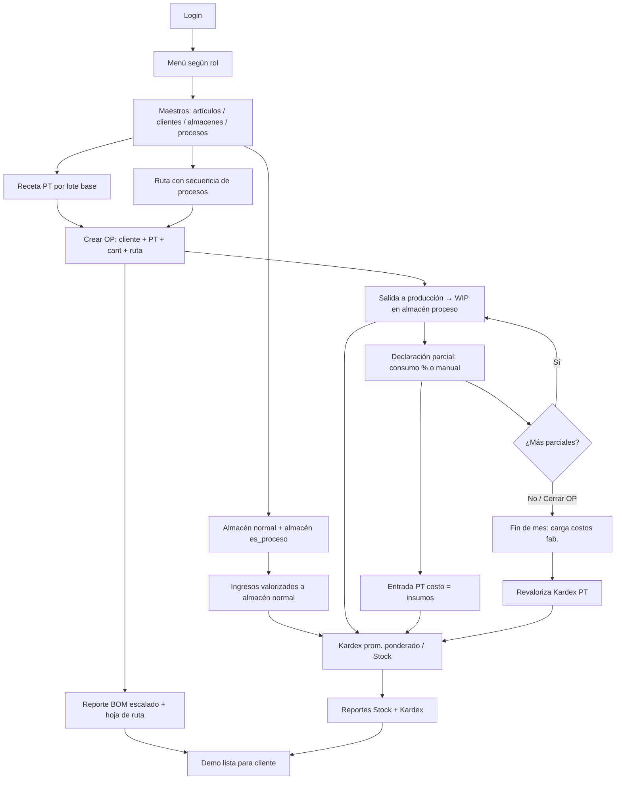

# Breadboarding — Software de Producción (prototipo)

Comportamiento esperado por pantalla (Shape Up). Decisiones de `01-DEFINE-GOAL.md` y modelo de `02-SHAPING.md` prevalecen. Sin mockups: lugares → affordances → conexiones → validaciones.

---

## Convenciones globales
- Sin permiso de pantalla: ítem no aparece en el menú; POST directo → 403 + mensaje “No tienes permiso para esta acción”.
- Guardar / Confirmar / Anular solo si el rol tiene la pantalla.
- Mensajes: éxito (verde, con nº de documento), error (rojo, bloquea el guardado).
- Toda operación de almacén genera `numero_transaccion` (TR-AAAA-######) y filas de Kardex.

---

## 1) Login
| | |
|--|--|
| **Lugares** | Formulario centrado |
| **Affordances** | Usuario, contraseña, botón **Ingresar** |
| **Conexiones** | Éxito → menú según rol. Fallo → permanece |
| **Validaciones / comportamiento** | Credenciales inválidas o usuario inactivo → “Usuario o contraseña incorrectos”. Sesión expirada al volver → redirige a login |

---

## 2) Menú (layout)
| | |
|--|--|
| **Lugares** | Barra lateral o superior con módulos; área de contenido; usuario + **Salir** |
| **Affordances** | Enlaces solo a pantallas del rol; badge con nombre/rol |
| **Conexiones** | Cada ítem → su pantalla |
| **Comportamiento** | Rol Consulta: solo reportes. Admin: ve Admin + resto asignado |

---

## 3) Admin — Usuarios
| | |
|--|--|
| **Lugares** | Lista + formulario Nuevo/Editar |
| **Affordances** | Lista: buscar, Nuevo, Editar, Activar/Desactivar. Form: username, nombres, email, password (solo create/reset), rol (select), activo |
| **Conexiones** | Rol → catálogo Roles |
| **Validaciones** | Username único. Password obligatorio al crear. No dejar al último Admin sin rol Admin |

---

## 4) Admin — Roles
| | |
|--|--|
| **Lugares** | Lista + form código/nombre/activo |
| **Affordances** | Nuevo, Editar, botón **Pantallas** |
| **Conexiones** | Pantallas → pantalla 5 |
| **Validaciones** | Código único. No borrar rol con usuarios asignados (mensaje) |

---

## 5) Admin — Rol ↔ Pantallas
| | |
|--|--|
| **Lugares** | Rol seleccionado + checklist de pantallas agrupadas por módulo |
| **Affordances** | Checkboxes, **Guardar** |
| **Conexiones** | Vuelve a Roles |
| **Comportamiento** | Al guardar, el menú de usuarios con ese rol refleja los cambios en el próximo request |

---

## 6) Maestro — Artículos
| | |
|--|--|
| **Lugares** | Lista (código, descripción, tipo, UM, activo) + form |
| **Affordances** | Buscar, Nuevo, Editar. Form: código, descripción, tipo_material (select seed, no editable fuera), unidad_medida, activo |
| **Conexiones** | Si tipo=PT → hint “crear receta” → Recetas |
| **Validaciones** | Código único. Tipo solo de la lista fija |

---

## 7) Maestro — Receta (lista de materiales por lote base)
| | |
|--|--|
| **Lugares** | Cabecera PT + lote_base; tabla de insumos |
| **Affordances** | Select PT (solo tipo PT sin receta, o editar existente), lote_base, agregar línea (artículo insumo ≠ PT, cantidad >0), quitar línea, Guardar |
| **Conexiones** | Artículos. Usada al crear OP / reporte BOM |
| **Validaciones** | Un PT = una receta. Al menos 1 insumo. Cantidades > 0. Insumo no puede ser el mismo PT |

---

## 8) Maestro — Clientes
| | |
|--|--|
| **Lugares** | Lista + form propios (tabla `cliente`) |
| **Affordances** | Código, RUC/documento, razón social, dirección, teléfono, activo |
| **Conexiones** | OP (select cliente) |
| **Validaciones** | Razón social obligatoria. Código único si se usa |

---

## 9) Maestro — Proveedores
| | |
|--|--|
| **Lugares** | Igual patrón que Clientes, tabla `proveedor` separada |
| **Affordances** | Mismos campos que cliente |
| **Conexiones** | Demo: referencial (ingreso no exige proveedor en v1; campo opcional si se agrega) |
| **Validaciones** | Igual que clientes |

---

## 10) Maestro — Trabajadores
| | |
|--|--|
| **Lugares** | Lista + form |
| **Affordances** | Código, nombres, tipo_documento (DNI/PASAPORTE/OTROS), número, activo |
| **Validaciones** | Código único. Número obligatorio |

---

## 11) Maestro — Almacenes
| | |
|--|--|
| **Lugares** | Lista + form |
| **Affordances** | Código, nombre, checkbox **Es proceso**, activo |
| **Conexiones** | Si es_proceso → solo aparece en Salida/Entrada prod. Si no → Ingreso, Salida, Transferencia, destino de Entrada prod |
| **Validaciones** | Código único. No desactivar almacén con stock > 0 (mensaje con saldo). No usar almacén proceso en ingreso compra / salida normal (UI filtra + backend rechaza) |

---

## 12) Maestro — Procesos
| | |
|--|--|
| **Lugares** | Lista + form código/nombre/activo |
| **Conexiones** | Armado de Rutas |
| **Validaciones** | Código único |

---

## 13) Maestro — Rutas
| | |
|--|--|
| **Lugares** | Cabecera ruta + secuencia de procesos (no ligada a PT) |
| **Affordances** | Código, nombre; agregar proceso con Nº secuencia; reordenar / quitar; Guardar |
| **Conexiones** | Select en OP. Hoja de ruta del reporte |
| **Validaciones** | Al menos 1 proceso. Secuencias únicas por ruta. Ruta independiente del producto |

---

## 14) Almacén — Ingreso
| | |
|--|--|
| **Lugares** | Cabecera + líneas |
| **Affordances** | Fecha, subtipo (compra nacional / importación / muestras / otros — mismo form), almacén destino (solo `es_proceso=false`), observación; líneas: artículo, cantidad >0, costo_unitario (S/) >0; Confirmar |
| **Conexiones** | Tras OK → mensaje con TR-…; Stock / Kardex reflejan ingreso |
| **Efecto Kardex** | Entrada valorizada; recalcula promedio ponderado del (artículo, destino) |
| **Validaciones** | ≥1 línea. Almacén no proceso. Costos en soles |

---

## 15) Almacén — Salida
| | |
|--|--|
| **Lugares** | Cabecera + líneas |
| **Affordances** | Fecha, almacén origen (no proceso), observación; líneas: artículo, cantidad; Confirmar |
| **Efecto Kardex** | Sale al promedio vigente; baja cantidad y valor; promedio no cambia |
| **Validaciones** | Stock suficiente por línea; si no → “Stock insuficiente de {artículo} en {almacén}: disponible X, pedido Y” |

---

## 16) Almacén — Transferencia
| | |
|--|--|
| **Lugares** | Origen, destino, líneas |
| **Affordances** | Ambos almacenes normales (`es_proceso=false`), distintos; artículo, cantidad; Confirmar |
| **Efecto Kardex** | Salida origen al prom. origen; entrada destino al mismo unitario (prom. destino se recalcula) |
| **Validaciones** | Origen ≠ destino. Stock suficiente en origen. Ninguno es proceso |

---

## 17) Almacén — Salida a producción
| | |
|--|--|
| **Lugares** | Cabecera OP + destino proceso + líneas |
| **Affordances** | Select OP (ABIERTA), almacén origen (normal), almacén destino (`es_proceso=true`), líneas artículo/cantidad; Confirmar |
| **Conexiones** | OP debe existir. WIP queda en destino proceso |
| **Efecto Kardex** | Sale origen → entra proceso al mismo unitario; stock WIP visible en reporte |
| **Validaciones** | OP obligatoria y abierta. Destino es_proceso. Stock origen OK |

---

## 18) Almacén / Prod — Entrada (declaración) de producción
| | |
|--|--|
| **Lugares** | Cabecera OP; bloque consumo; bloque PT |
| **Affordances** | OP abierta; fecha; cantidad_pt >0; almacén origen proceso; almacén destino normal; **modo consumo**: (a) % sobre lo enviado a prod de esa OP aún en WIP, o (b) manual: checklist de insumos en WIP de la OP con cantidad editable ≤ disponible; Confirmar |
| **Conexiones** | Crea movimiento ENTRADA_PROD + `declaracion_produccion` + consumos. Varias parciales hasta cerrar OP |
| **Efecto Kardex** | Consume insumos del proceso (salida WIP). Entra PT a destino con `costo_insumos` y `costo_fabricacion=0`; unitario_pt = insumos / cant_pt. WIP no consumido permanece |
| **Validaciones** | OP abierta. Cantidades de consumo ≤ WIP de esa OP. % entre 0 y 100. Stock proceso suficiente. Mensaje si no hay WIP: “No hay stock en proceso para esta OP” |

---

## 19) Producción — Órdenes (OP)
| | |
|--|--|
| **Lugares** | Lista (nº, cliente, PT, cant, estado, fecha) + form crear + detalle |
| **Affordances** | Nuevo: cliente, PT (tipo PT), cantidad >0, fecha, **ruta** (select libre, no auto desde PT); Guardar → estado ABIERTA. Acciones: ver, **Cerrar** (si ya no se esperan más entradas), ir a reportes BOM/ruta, registrar salida/entrada prod |
| **Conexiones** | Receta del PT (para BOM). Ruta (hoja). Movimientos y declaraciones |
| **Validaciones** | PT con receta (si no → “El PT no tiene receta; créala antes”). Ruta obligatoria. Cerrar solo si usuario confirma; OP cerrada no admite más salidas/entradas prod |

---

## 20) Producción — Carga masiva costo de fabricación (fin de mes)
| | |
|--|--|
| **Lugares** | Cabecera periodo + grilla de declaraciones del periodo |
| **Affordances** | Periodo YYYY-MM; lista declaraciones (OP, fecha, cant_pt, costo_insumos, costo_fab actual, revalorizada); input monto S/ por fila (o pegado tabular simple); **Procesar carga** |
| **Efecto Kardex** | Suma monto al valor de la entrada PT de esa declaración; recalcula prom. desde esa fecha hacia adelante en (PT, almacén); marca revalorizada |
| **Validaciones** | Monto ≥ 0. Declaración no duplicada en otra carga. Confirmar “Esta acción reprocesa el Kardex” |

---

## 21) Reporte — Lista de materiales + hoja de ruta (por OP)
| | |
|--|--|
| **Lugares** | Filtro OP → dos bloques imprimibles |
| **Affordances** | Select/buscar OP; **Ver** / **Imprimir** |
| **Comportamiento** | BOM: cada insumo de la receta × (`cant_OP / lote_base`). Hoja de ruta: procesos de la ruta elegida en la OP, ordenados por secuencia. Sin editar |

---

## 22) Reporte — Stock por almacén
| | |
|--|--|
| **Lugares** | Filtros almacén / artículo; grilla |
| **Affordances** | Columnas: almacén, artículo, cantidad, costo_promedio, valor, **último nº transacción** (o nº de la última mov. que afectó el saldo) |
| **Comportamiento** | Incluye almacenes proceso (WIP). Solo lectura |

---

## 23) Reporte — Kardex / movimientos
| | |
|--|--|
| **Lugares** | Filtros: artículo, almacén, rango fechas |
| **Affordances** | Grilla cronológica: fecha, TR, tipo, entrada, salida, saldo_cant, costos, saldo_valor, prom |
| **Comportamiento** | Refleja revalorizaciones. Export/imprimir opcional en demo |

---

## Flujo demo completo (mermaid)

---

## Criterio “listo para spec”
Cada pantalla de arriba tiene lugares, botones/campos, conexiones y reglas de error/Kardex escritas. Siguiente: `04` o `ESPECIFICACION.md` (to spec) y referencia visual opcional de OP + declaración + Kardex.
