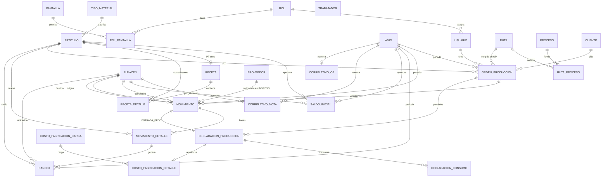

# ESPECIFICACIÓN — Software de Producción (prototipo)

Documento único y autosuficiente para implementar el prototipo **Django 5 + Templates + SQLite** en local.  
Fuentes: `01-DEFINE-GOAL.md` (sección **Decisiones** prevalece), `02-SHAPING.md`, `03-BREADBOARDING.md`, `04-VISUAL-REFERENCE.md`, `04-visual/index.html`.  
Si hay contradicciones entre documentos, manda la decisión más reciente (listadas al final).

**Versión:** 1.0 · **Fecha:** 2026-11-01 (America/Lima) · **Idioma UI:** español

---

## 1. Objetivo y criterio de éxito

Prototipo web en Python, ejecutado con `runserver` en una laptop, para presentar al cliente.  
Alcance comercial: control de almacén + control de producción + costeo de fabricación. Precio orientativo USD 1,500 (USD 500/módulo).

**Demo exitosa =** login con roles → crear maestros a mano → crear receta y ruta → crear OP → ingresos valorizados → salida a producción (WIP) → declaración parcial (% o manual) → reportes BOM/ruta, stock y Kardex → carga de costos de fabricación de fin de mes y revalorización visible en Kardex.

---

## 2. Alcance y fuera de alcance

### En alcance (demo F1–F6)
- Auth multiusuario, roles y pantallas.
- Maestros: años, artículos (+ tipos fijos), clientes, proveedores, trabajadores (solo catálogo), almacenes (`es_proceso`), procesos, rutas (independientes del PT), recetas por lote base.
- Operaciones de almacén: ingreso (subtipos), salida, transferencia, salida a producción, entrada/declaración de producción. Todas actualizan Kardex.
- Orden de producción (sin cierre en demo).
- Costeo: valorización manual en ingresos (S/); Kardex promedio ponderado; carga masiva de costo de fabricación por declaración a fin de mes + revalorización.
- Cierre de año: saldo final → saldo inicial del año siguiente.
- Numeración: nota `CODALM-AÑO-CORRELATIVO`; OP `OP-AÑO-CORRELATIVO`.
- Reportes: BOM + hoja de ruta por OP; stock (con nº de nota); Kardex/movimientos.
- UI: shell estilo Odoo (sidebar `#2c2c2c`, acento `#714B67`) + formularios densos cabecera/grilla.

### Fuera de alcance
- Módulo de compras / costo “real” integrado.
- Carga masiva Excel de maestros.
- Cierre de órdenes de producción (UI/acción).
- Campos configurables tipo Odoo Studio.
- Deploy cloud (Vercel/Supabase/PostgreSQL en producción). PostgreSQL queda previsto pero no es requisito de la demo.
- Anulación/edición de movimientos ya confirmados (solo crear; corrección vía movimiento inverso si se necesita en el futuro).
- Lote/ubicación física avanzada, series, multi-moneda, IGV, contabilidad.
- Asociación trabajador ↔ OP/declaración.

---

## 3. Stack técnico

| Pieza | Elección |
|-------|----------|
| Framework | Django 5.x |
| Front | Django Templates (+ HTMX opcional). Sin SPA/Node. |
| BD demo | SQLite (`db.sqlite3`) |
| Auth | `django.contrib.auth.User` o modelo propio enlazado + `Rol` / `Pantalla` / `RolPantalla` |
| Servidor demo | `python manage.py runserver` |
| Zona horaria | `America/Lima` |
| Idioma | `es` |
| Decimales | `Decimal` con 4 decimales en cantidades y montos (`max_digits=14, decimal_places=4`) |

---

## 4. Modelo de datos definitivo

Convenciones:
- PK: `id` BigAutoField.
- Soft-flag: `activo` BooleanField default True donde aplique.
- Timestamps: `created_at` / `updated_at` donde se indique.
- Montos y cantidades: `DecimalField(14,4)`.
- No hard-delete de movimientos ni de filas Kardex.

### 4.1 Auth y permisos

#### `rol`
| Columna | Tipo | Notas |
|---------|------|-------|
| id | PK | |
| codigo | CharField(32) unique | ej. ADMIN, ALMACENERO |
| nombre | CharField(100) | |
| activo | Boolean | |

#### `pantalla`
| Columna | Tipo | Notas |
|---------|------|-------|
| id | PK | |
| codigo | CharField(64) unique | seed fijo, ver §7 |
| nombre | CharField(120) | |
| modulo | CharField(40) | Admin, Maestros, Almacén, Producción, Reportes |

#### `rol_pantalla`
| Columna | Tipo | Notas |
|---------|------|-------|
| id | PK | |
| rol_id | FK → rol | |
| pantalla_id | FK → pantalla | |
| | | **Unique**(rol_id, pantalla_id) |

#### `usuario` (perfil de app)
Usar `AUTH_USER_MODEL` de Django (`username`, `password`, `is_active`, `first_name`/`last_name` o `nombres`, `email`) **más**:
| Columna | Tipo | Notas |
|---------|------|-------|
| rol_id | FK → rol | obligatorio; un rol por usuario |
| nombres | CharField(150) | si no se usan first/last |

Middleware/decorator: toda vista de escritura/lectura exige que `usuario.rol` tenga la `pantalla.codigo` correspondiente. Sin permiso: menú oculto + POST → **403**.

---

### 4.2 Periodo / años y correlativos

#### `anio`
| Columna | Tipo | Notas |
|---------|------|-------|
| id | PK | **id_anio** usado como FK |
| anio | PositiveIntegerField unique | ej. 2026 |
| activo | Boolean | año de trabajo actual (solo uno recomendado activo) |
| cerrado | Boolean default False | si True, no admite movimientos ni OP nuevas |
| fecha_cierre | DateTimeField null | |
| cerrado_por_id | FK → user null | |

#### `correlativo_nota`
Correlativo de notas de almacén **por almacén y año**.
| Columna | Tipo | Notas |
|---------|------|-------|
| id | PK | |
| anio_id | FK → anio | |
| almacen_id | FK → almacen | |
| ultimo | PositiveIntegerField default 0 | |
| | | **Unique**(anio_id, almacen_id) |

Formato nota: `{almacen.codigo}-{anio.anio}-{ultimo:06d}`  
Ejemplo: `ALM01-2026-000001`

#### `correlativo_op`
| Columna | Tipo | Notas |
|---------|------|-------|
| id | PK | |
| anio_id | FK → anio | unique |
| ultimo | PositiveIntegerField default 0 | |

Formato OP: `OP-{anio.anio}-{ultimo:04d}`  
Ejemplo: `OP-2026-0001`

#### `saldo_inicial`
Saldo de apertura por año (tras cierre anual o carga manual del primer año).
| Columna | Tipo | Notas |
|---------|------|-------|
| id | PK | |
| anio_id | FK → anio | |
| almacen_id | FK → almacen | |
| articulo_id | FK → articulo | |
| cantidad | Decimal(14,4) | ≥ 0 |
| costo_promedio | Decimal(14,4) | |
| valor | Decimal(14,4) | = cantidad × costo_promedio (validar) |
| | | **Unique**(anio_id, almacen_id, articulo_id) |

Índice: `(anio_id, almacen_id, articulo_id)`.

Al **cerrar año N**: para cada (almacén, artículo) con stock/Kardex final ≠ 0 en N, insertar/actualizar `saldo_inicial` del año N+1 (crearlo si no existe) con cantidad/valor/promedio finales; marcar `anio N` como `cerrado=True`.

---

### 4.3 Maestros

#### `tipo_material` (fija, solo seed, **no editable** en UI)
| codigo | nombre |
|--------|--------|
| MP | Materia prima |
| AUX | Materiales auxiliares |
| REP | Repuestos y suministros |
| ENV | Envases y embalajes |
| DESP | Desperdicios |
| PT | Producto terminado |

Columnas: id, codigo unique, nombre.

#### `articulo`
| Columna | Tipo | Notas |
|---------|------|-------|
| id | PK | |
| codigo | CharField(40) unique | |
| descripcion | CharField(200) | |
| tipo_material_id | FK → tipo_material | |
| unidad_medida | CharField(20) | kg, m, und, cono, … |
| activo | Boolean | |

#### `cliente`
| Columna | Tipo | Notas |
|---------|------|-------|
| id | PK | |
| codigo | CharField(40) unique | |
| ruc_documento | CharField(20) | |
| razon_social | CharField(200) | obligatorio |
| direccion | CharField(250) blank | |
| telefono | CharField(40) blank | |
| activo | Boolean | |

#### `proveedor` (tabla **separada** de cliente)
Mismas columnas que `cliente`.

#### `trabajador` (solo catálogo en demo)
| Columna | Tipo | Notas |
|---------|------|-------|
| id | PK | |
| codigo | CharField(40) unique | |
| nombres | CharField(150) | |
| tipo_documento | CharField(20) | DNI / PASAPORTE / OTROS |
| numero_documento | CharField(30) | obligatorio |
| activo | Boolean | |

#### `almacen`
| Columna | Tipo | Notas |
|---------|------|-------|
| id | PK | |
| codigo | CharField(20) unique | **ej. ALM01, PROC01** — usado en numeración de nota |
| nombre | CharField(120) | |
| es_proceso | Boolean default False | si True: solo salida/entrada producción |
| activo | Boolean | |

#### `proceso`
| Columna | Tipo | Notas |
|---------|------|-------|
| id | PK | |
| codigo | CharField(40) unique | |
| nombre | CharField(120) | |
| activo | Boolean | |

#### `ruta` (**independiente** del producto terminado)
| Columna | Tipo | Notas |
|---------|------|-------|
| id | PK | |
| codigo | CharField(40) unique | |
| nombre | CharField(120) | |
| activo | Boolean | |

#### `ruta_proceso`
| Columna | Tipo | Notas |
|---------|------|-------|
| id | PK | |
| ruta_id | FK → ruta | |
| proceso_id | FK → proceso | |
| secuencia | PositiveIntegerField | |
| | | **Unique**(ruta_id, secuencia) |

---

### 4.4 Receta (BOM por lote base)

#### `receta`
| Columna | Tipo | Notas |
|---------|------|-------|
| id | PK | |
| articulo_pt_id | FK → articulo | debe ser tipo PT; **unique** |
| lote_base | Decimal(14,4) | > 0; ej. 100 |
| activo | Boolean | |

#### `receta_detalle`
| Columna | Tipo | Notas |
|---------|------|-------|
| id | PK | |
| receta_id | FK → receta | CASCADE |
| articulo_insumo_id | FK → articulo | ≠ PT de la receta |
| cantidad_por_lote | Decimal(14,4) | > 0 |
| | | Unique opcional (receta, articulo_insumo) |

**Escala en OP:** `cantidad_requerida = cantidad_OP / lote_base × cantidad_por_lote`

---

### 4.5 Orden de producción

#### `orden_produccion`
| Columna | Tipo | Notas |
|---------|------|-------|
| id | PK | |
| numero | CharField(30) unique | `OP-AAAA-####` |
| anio_id | FK → anio | **obligatorio** |
| cliente_id | FK → cliente | |
| articulo_pt_id | FK → articulo | tipo PT + con receta |
| cantidad | Decimal(14,4) | > 0 |
| fecha_registro | DateField | |
| ruta_id | FK → ruta | elegida al crear; no auto desde PT |
| estado | CharField(20) | `ABIERTA` (demo: siempre ABIERTA; valor CERRADA reservado, sin UI de cierre) |
| created_by_id | FK → user | |
| created_at | DateTimeField | |

Índices: `(anio_id)`, `(estado)`, `(articulo_pt_id)`.

---

### 4.6 Movimientos de almacén + Kardex

#### `movimiento` (cabecera / “nota”)
| Columna | Tipo | Notas |
|---------|------|-------|
| id | PK | |
| numero_nota | CharField(40) unique | `CODALM-AÑO-CORRELATIVO` |
| anio_id | FK → anio | **obligatorio**; año no cerrado |
| tipo | CharField(20) | INGRESO / SALIDA / TRANSFERENCIA / SALIDA_PROD / ENTRADA_PROD |
| subtipo | CharField(20) null | COMPRA_NAC / IMPORTACION / MUESTRAS / OTROS (solo INGRESO) |
| fecha | DateField | fecha de registro |
| fecha_hora | DateTimeField auto | |
| almacen_id | FK → almacen | almacén que **gobierna el correlativo** (ver reglas §5.8) |
| almacen_origen_id | FK → almacen null | |
| almacen_destino_id | FK → almacen null | |
| orden_produccion_id | FK → OP null | obligatorio en SALIDA_PROD y ENTRADA_PROD |
| proveedor_id | FK → proveedor null | **obligatorio si tipo=INGRESO** |
| cliente_id | FK → cliente null | opcional (salidas/otros) |
| tipo_comprobante | CharField(20) blank | FACTURA / BOLETA / OTROS |
| serie_doc | CharField(20) blank | |
| numero_doc | CharField(30) blank | |
| fecha_doc | DateField null | |
| observacion | TextField blank | |
| created_by_id | FK → user | |
| created_at | DateTimeField | |

**Almacén del correlativo (`almacen_id`):**
- INGRESO → destino
- SALIDA → origen
- TRANSFERENCIA → origen
- SALIDA_PROD → origen (normal)
- ENTRADA_PROD → destino (almacén PT normal)

Índices: `(anio_id, fecha)`, `(tipo)`, `(orden_produccion_id)`, `(almacen_id)`.

#### `movimiento_detalle`
| Columna | Tipo | Notas |
|---------|------|-------|
| id | PK | |
| movimiento_id | FK → movimiento | CASCADE |
| articulo_id | FK → articulo | |
| cantidad | Decimal(14,4) | > 0 |
| costo_unitario | Decimal(14,4) | en ingreso: lo escribe el usuario; en salidas: promedio vigente |
| costo_total | Decimal(14,4) | cantidad × costo_unitario |
| lote_ref | CharField(40) blank | referencial UI |
| ubicacion_ref | CharField(40) blank | referencial UI |
| kilo_ref / und_ref / metro_ref | Decimal null | opcionales UI |
| observacion | CharField(200) blank | |

#### `kardex`
Una fila por impacto en un (artículo, almacén). Transferencia y salida/entrada prod generan **dos** filas (origen y destino) ligadas al mismo detalle o a dos detalles según implementación; lo importante es trazabilidad a `movimiento_detalle_id`.

| Columna | Tipo | Notas |
|---------|------|-------|
| id | PK | |
| anio_id | FK → anio | denormalizado para consultas por año |
| articulo_id | FK → articulo | |
| almacen_id | FK → almacen | |
| movimiento_detalle_id | FK → movimiento_detalle | |
| orden_produccion_id | FK → OP null | útil en almacenes proceso |
| fecha | DateField | |
| fecha_hora | DateTimeField | |
| tipo_mov | CharField(20) | mismo enum / + SALDO_INICIAL |
| numero_nota | CharField(40) | copia |
| cantidad_entrada | Decimal(14,4) default 0 | |
| cantidad_salida | Decimal(14,4) default 0 | |
| saldo_cantidad | Decimal(14,4) | |
| costo_unit_mov | Decimal(14,4) | unitario del movimiento |
| costo_unit_promedio | Decimal(14,4) | promedio tras el movimiento |
| valor_entrada | Decimal(14,4) default 0 | |
| valor_salida | Decimal(14,4) default 0 | |
| saldo_valor | Decimal(14,4) | |
| es_revalorizacion | Boolean default False | ajuste de valor sin cantidad |

**Índice obligatorio:** `(articulo_id, almacen_id, anio_id, fecha, id)` para stock y reproceso.

#### `stock_actual` (tabla caché, recalculable)
| Columna | Tipo | Notas |
|---------|------|-------|
| articulo_id | FK | |
| almacen_id | FK | |
| anio_id | FK | stock del año abierto |
| cantidad | Decimal | |
| costo_promedio | Decimal | |
| valor | Decimal | |
| ultima_nota | CharField(40) | último numero_nota que afectó |
| | | **Unique**(articulo_id, almacen_id, anio_id) |

Al consultar stock del año: si no hay movimientos, usar `saldo_inicial`; si hay, último Kardex del año (o la caché).

---

### 4.7 Declaración de producción y costo de fabricación

#### `declaracion_produccion`
| Columna | Tipo | Notas |
|---------|------|-------|
| id | PK | |
| orden_produccion_id | FK → OP | |
| movimiento_id | FK → movimiento | tipo ENTRADA_PROD; OneToOne recomendado |
| anio_id | FK → anio | |
| fecha | DateField | |
| cantidad_pt | Decimal(14,4) | > 0 |
| modo_consumo | CharField(20) | PORCENTAJE / MANUAL |
| porcentaje_consumo | Decimal(8,4) null | 0–100 si PORCENTAJE |
| costo_insumos | Decimal(14,4) | Σ consumos |
| costo_fabricacion | Decimal(14,4) default 0 | se llena a fin de mes |
| costo_unitario_pt | Decimal(14,4) | (insumos + fab) / cant_pt |
| revalorizada | Boolean default False | |
| created_by_id | FK | |
| created_at | DateTimeField | |

#### `declaracion_consumo`
| Columna | Tipo | Notas |
|---------|------|-------|
| id | PK | |
| declaracion_id | FK → declaracion | CASCADE |
| articulo_id | FK → articulo | |
| cantidad_consumida | Decimal(14,4) | > 0; ≤ WIP disponible de esa OP |
| costo_unitario | Decimal(14,4) | del WIP/promedio proceso |
| costo_total | Decimal(14,4) | |

#### `costo_fabricacion_carga`
| Columna | Tipo | Notas |
|---------|------|-------|
| id | PK | |
| periodo | CharField(7) | YYYY-MM |
| anio_id | FK → anio | |
| fecha_carga | DateTimeField | |
| observacion | TextField blank | |
| created_by_id | FK | |

#### `costo_fabricacion_detalle`
| Columna | Tipo | Notas |
|---------|------|-------|
| id | PK | |
| carga_id | FK → carga | |
| declaracion_id | FK → declaracion | **unique** (una asignación activa) |
| monto_soles | Decimal(14,4) | ≥ 0 |

---

## 5. Diagrama ER (Mermaid)



---

## 6. Reglas de negocio (numeradas)

### RB-01 · Tipos de material
Lista fija seed. La UI no permite crear/editar/borrar tipos.

### RB-02 · Clientes ≠ proveedores
Tablas y pantallas separadas.

### RB-03 · Almacenes proceso
`es_proceso=true` solo puede usarse como destino de SALIDA_PROD y origen de ENTRADA_PROD.  
Backend **rechaza** su uso en INGRESO, SALIDA normal y TRANSFERENCIA (ambos lados). UI filtra selects.

### RB-04 · Rutas independientes
La ruta **no** se asocia al PT. Se elige al crear la OP. No auto-cargar ruta al seleccionar PT.

### RB-05 · Receta por lote base
Un PT → una receta. Escala: `cant_OP / lote_base × cant_por_lote`. No crear OP si el PT no tiene receta activa con ≥1 insumo.

### RB-06 · Kardex promedio ponderado — ingreso
Usuario informa `costo_unitario` en S/.  
`nuevo_prom = (saldo_valor + cant×costo) / (saldo_cant + cant)`  
Actualiza saldo cantidad/valor del (artículo, almacén destino, año).

### RB-07 · Kardex — salida / salida de transferencia / salida a prod
Sale al `costo_unit_promedio` vigente del almacén origen (año). No cambia el promedio del origen (baja cant y valor proporcional).  
Transferencia: entrada en destino al mismo unitario; el promedio del destino se recalcula como ingreso valorizado (RB-06).

### RB-08 · Stock negativo prohibido
Ninguna salida/consumo/transferencia puede dejar `saldo_cantidad < 0` en (artículo, almacén, año).  
Mensaje: `Stock insuficiente de {código} en {almacén}: disponible {X}, pedido {Y}`. Transacción atómica: si una línea falla, rollback de toda la nota.

### RB-09 · Salida a producción
- OP obligatoria y `estado=ABIERTA`.
- Origen: almacén `es_proceso=false`.
- Destino: almacén `es_proceso=true`.
- Genera Kardex salida origen + entrada destino.
- WIP de la OP = Σ cantidades enviadas a proceso para esa OP − Σ consumidas en declaraciones de esa OP (por artículo). El WIP vive en el almacén proceso y es **visible en stock**.

### RB-10 · Entrada / declaración de producción (parciales permitidas)
- OP ABIERTA; varias declaraciones por OP (demo sin cierre).
- Usuario elige modo:
  - **PORCENTAJE:** 0 < % ≤ 100 sobre el WIP pendiente de cada artículo enviado a esa OP (o sobre el total enviado aún en WIP — aplicar el % a cada artículo con WIP>0 de esa OP).
  - **MANUAL:** usuario selecciona artículos/cantidades ≤ WIP disponible de esa OP.
- Consume insumos (salida Kardex del almacén proceso) + entra PT al almacén destino normal.
- `costo_insumos = Σ consumos`; `costo_fabricacion = 0` al declarar.
- `costo_unitario_pt = costo_insumos / cantidad_pt` (inicial).
- Lo no consumido permanece como WIP.

### RB-11 · Costo de fabricación fin de mes
Carga masiva por periodo YYYY-MM: monto S/ por declaración.  
- Suma monto a `costo_fabricacion` de la declaración.
- Inserta movimiento/ajuste de revalorización en Kardex del PT (misma fecha de la declaración o fecha de carga — **usar fecha de la declaración** para el orden cronológico; marcar `es_revalorizacion=true`, cantidad 0, valor_entrada = monto).
- Recalcula `costo_unitario_pt = (costo_insumos + costo_fabricacion) / cantidad_pt`.
- **Reprocesa** todos los Kardex posteriores del mismo (artículo PT, almacén, año) desde esa fecha para corregir promedios/saldos valor.
- Marca `revalorizada=true`. No permitir segunda carga sobre la misma declaración sin revertir (unique en detalle).

### RB-12 · Proveedor obligatorio en ingreso
`proveedor_id` requerido si `tipo=INGRESO`. Validar en form y en servicio de dominio.

### RB-13 · Trabajadores
Solo CRUD catálogo. No FK desde OP ni declaración en esta versión.

### RB-14 · Año obligatorio y cerrado
Todo `movimiento` y toda `orden_produccion` llevan `anio_id`.  
No crear movimientos/OP en año `cerrado=True`.  
La fecha del movimiento debe pertenecer al año calendario de `anio.anio` (validar `fecha.year == anio.anio`).

### RB-15 · Numeración de nota
Al confirmar movimiento: en transacción, lock fila `correlativo_nota` (anio, almacen_correlativo), `ultimo += 1`, asignar `numero_nota = f"{almacen.codigo}-{anio.anio}-{ultimo:06d}"`.

### RB-16 · Numeración de OP
Al crear OP: lock `correlativo_op` del año, `ultimo += 1`, `numero = f"OP-{anio.anio}-{ultimo:04d}"`.

### RB-17 · Cierre de año
Proceso (pantalla Admin o comando de gestión):
1. Verificar año no cerrado.
2. Para cada (almacen, articulo) con cantidad≠0 o valor≠0 al final del año (último Kardex o stock_actual), crear `saldo_inicial` en año N+1 (crear `anio` N+1 si falta).
3. Opcional: generar filas Kardex `SALDO_INICIAL` en N+1 el 1 de enero.
4. Marcar año N `cerrado=True`.
5. Consultas de stock/Kardex del año N+1 **parten** de `saldo_inicial` y solo leen movimientos de N+1 (no recorren histórico N).

### RB-18 · Sin cierre de OP en demo
No exponer botón/acción Cerrar. Estado permanece `ABIERTA`. El campo `CERRADA` existe en el modelo por si se habilita después; no implementar transición.

### RB-19 · Permisos por rol
Cada rol tiene conjunto de pantallas. Usuario hereda un rol. Ocultar menú + bloquear POST (403). Rol **Consulta**: solo reportes (GET).

### RB-20 · Atomicidad
Crear nota = cabecera + detalles + filas Kardex + actualización stock_actual en **una** `transaction.atomic()`.

### RB-21 · Documento de referencia
Campos tipo/serie/número/fecha doc son opcionales en todos los tipos excepto que la UI los muestre; no bloquean el guardado si van vacíos (salvo reglas futuras).

---

## 7. Pantallas, campos, validaciones y permisos

### 7.1 Catálogo de pantallas (seed `pantalla.codigo`)

| codigo | Módulo | Nombre |
|--------|--------|--------|
| admin.usuarios | Admin | Usuarios |
| admin.roles | Admin | Roles |
| admin.rol_pantallas | Admin | Rol ↔ pantallas |
| admin.anios | Admin | Años / cierre anual |
| mae.articulos | Maestros | Artículos |
| mae.recetas | Maestros | Recetas (BOM) |
| mae.clientes | Maestros | Clientes |
| mae.proveedores | Maestros | Proveedores |
| mae.trabajadores | Maestros | Trabajadores |
| mae.almacenes | Maestros | Almacenes |
| mae.procesos | Maestros | Procesos |
| mae.rutas | Maestros | Rutas |
| alm.ingreso | Almacén | Ingreso |
| alm.salida | Almacén | Salida |
| alm.transferencia | Almacén | Transferencia |
| alm.salida_prod | Almacén | Salida a producción |
| alm.entrada_prod | Almacén | Declaración / entrada producción |
| prod.ordenes | Producción | Órdenes de producción |
| prod.carga_costos_fab | Producción | Carga costos fabricación |
| rep.bom_ruta_op | Reportes | BOM + hoja de ruta |
| rep.stock | Reportes | Stock |
| rep.kardex | Reportes | Kardex |

### 7.2 Roles sugeridos (seed)

| Rol | Pantallas |
|-----|-----------|
| Admin | Todas |
| Almacenero | mae.* (lectura artículos/almacenes) + alm.* + rep.stock + rep.kardex |
| JefeProduccion | mae.recetas, mae.rutas, mae.procesos, mae.clientes, mae.articulos + prod.* + alm.salida_prod + alm.entrada_prod + rep.* |
| Consulta | rep.* solamente |

### 7.3 Detalle por pantalla

**Login** — usuario, contraseña. Fallo genérico. Usuario inactivo rechazado.

**Admin · Usuarios** — lista + form: username, nombres, email, password (crear/reset), rol, activo. Username único. No dejar el sistema sin ningún Admin activo.

**Admin · Roles** — codigo, nombre, activo. No borrar si tiene usuarios. Botón Pantallas → checklist por módulo.

**Admin · Años** — listar años; crear año; acción **Cerrar año** (confirma) ejecuta RB-17. Mostrar si está cerrado.

**Maestro · Artículos** — codigo, descripcion, tipo (select seed), UM, activo. Código único.

**Maestro · Recetas** — select PT sin receta (o editar), lote_base>0, grilla insumos (artículo≠PT, cant>0), ≥1 línea.

**Maestro · Clientes / Proveedores** — codigo, ruc_documento, razon_social*, direccion, telefono, activo. Pantallas y tablas distintas.

**Maestro · Trabajadores** — codigo*, nombres*, tipo_documento, numero_documento*, activo.

**Maestro · Almacenes** — codigo* (usado en notas), nombre*, es_proceso, activo. No desactivar con stock>0.

**Maestro · Procesos** — codigo, nombre, activo.

**Maestro · Rutas** — codigo, nombre; secuencias de procesos únicas; ≥1 proceso; sin FK a PT.

**Almacén · Ingreso** — año (activo), fecha, subtipo, almacén destino (no proceso), **proveedor obligatorio**, doc. ref. opcional, obs.; líneas: artículo, cant>0, costo_unit>0, lote/ubicación opcionales. ≥1 línea. Efecto: RB-06, RB-12, RB-15.

**Almacén · Salida** — año, fecha, almacén origen (no proceso), obs.; líneas cant; stock OK (RB-08).

**Almacén · Transferencia** — origen≠destino, ambos no proceso; stock origen OK; RB-07.

**Almacén · Salida a producción** — OP abierta, origen normal, destino es_proceso; RB-09.

**Almacén · Declaración** — OP, fecha, cant_pt, origen proceso, destino normal, modo % o manual; tabs Productos obtenidos / Insumos utilizados; totales (cant PT, costo insumos, costo fab=0, unitario). RB-10.

**Producción · OP** — cliente, PT (con receta), cantidad, fecha, ruta (select libre), año. Genera numero OP. Lista + detalle. **Sin** botón Cerrar. Links a BOM/ruta, salida prod, declaración.

**Producción · Carga costos fab.** — periodo YYYY-MM; grilla declaraciones; monto≥0; confirmar reproceso; RB-11.

**Reportes** — ver §8.

UI común: mensajes éxito con nº de nota/OP; errores en rojo; contador “Registro N de N”; Guardar / Cancelar. Shell Odoo según `04-VISUAL-REFERENCE.md`.

---

## 8. Reportes (columnas)

### 8.1 BOM + hoja de ruta por OP (`rep.bom_ruta_op`)
Filtro: OP.  
**Bloque BOM:** código insumo, descripción, UM, cant_por_lote, cant_requerida (= escala), lote_base, cant_OP.  
**Bloque ruta:** secuencia, código proceso, nombre proceso.  
Solo lectura / imprimir.

### 8.2 Stock (`rep.stock`)
Filtros: año, almacén (incl. proceso), artículo.  
Columnas: almacén (código/nombre), es_proceso, artículo código, descripción, UM, cantidad, costo_promedio, valor, **última nota** (`numero_nota`).

### 8.3 Kardex (`rep.kardex`)
Filtros: año, artículo, almacén, desde/hasta fecha.  
Columnas: fecha, numero_nota, tipo_mov, entrada, salida, saldo_cant, valor_entrada, valor_salida, saldo_valor, prom_unit, flag revalorización, OP (si aplica).  
Orden: fecha, id. Debe reflejar revalorizaciones.

---

## 9. Datos semilla para la demo (marcados EJEMPLO)

> Todo lo textil/nombres comerciales es **ejemplo** para la presentación.

### 9.1 Años y correlativos
- Año 2026 activo, no cerrado.
- Correlativos en 0 para almacenes seed.

### 9.2 Roles y usuarios
| username | rol | password (solo demo) |
|----------|-----|----------------------|
| maribel | Admin | demo-admin |
| almacenero | Almacenero | demo-alm |
| jefeprod | JefeProduccion | demo-prod |
| consulta | Consulta | demo-consulta |

### 9.3 Tipos de material
Los 6 fijos (MP, AUX, REP, ENV, DESP, PT).

### 9.4 Almacenes (ejemplo)
| codigo | nombre | es_proceso |
|--------|--------|------------|
| ALM01 | Almacén de compras | false |
| ALM02 | Materia prima | false |
| ALM03 | Producto terminado | false |
| PROC01 | En proceso tejido | true |

### 9.5 Artículos (ejemplo)
| codigo | descripcion | tipo | UM |
|--------|-------------|------|-----|
| MP-HIL-20/1 | Hilo algodón 20/1 crudo | MP | kg |
| MP-TEL-JER | Tela jersey 180 g/m² | MP | m |
| AUX-BOT-14 | Botón 14 mm blanco | AUX | und |
| ENV-BOL-P | Bolsa polietileno polo | ENV | und |
| PT-POL-PIQ-B | Polo piqué blanco M | PT | und |

### 9.6 Receta (ejemplo)
PT `PT-POL-PIQ-B`, lote_base **100** und:
- MP-HIL-20/1 → 25 kg
- MP-TEL-JER → 80 m
- AUX-BOT-14 → 300 und
- ENV-BOL-P → 100 und

### 9.7 Procesos y ruta (ejemplo)
Procesos: TEJ Tejido, TEN Teñido, COR Corte, COS Costura, ACA Acabado.  
Ruta `RUTA-POLO-01` “Polo básico”: 1 TEJ → 2 TEN → 3 COR → 4 COS → 5 ACA.

### 9.8 Terceros (ejemplo)
- Cliente: CLI-001 · Textiles Lima S.A.C. · RUC 20555111222  
- Proveedor: PROV-001 · Hilos del Sur S.A.C. · RUC 20123456789  
- Trabajador: TR-001 · Juan Pérez · DNI 12345678  

### 9.9 Flujo demo sugerido (script)
1. Login maribel.  
2. Ingreso a ALM01: 100 kg hilo @ 2.00; 100 kg hilo @ 4.00 → prom 3.00; tela 250 m @ 4.50. Proveedor PROV-001.  
3. Transferencia ALM01→ALM02 de 40 kg hilo.  
4. Crear OP: cliente Textiles Lima, PT polo, cant 500, ruta RUTA-POLO-01 → `OP-2026-0001`.  
5. Salida a prod OP → PROC01: 40 kg hilo (u otros insumos).  
6. Declaración parcial: 200 und PT, modo 50% (o manual).  
7. Ver BOM escalado, stock (WIP), Kardex.  
8. Carga costo fab. S/ 40 (o monto demo) a la declaración → verificar revalorización PT.

---

## 10. Estructura de proyecto Django sugerida

```
software_produccion/          # repo / carpeta raíz
  manage.py
  requirements.txt            # Django>=5,<6 ; … 
  README.md
  config/
    __init__.py
    settings.py               # SQLITE, TIME_ZONE=America/Lima, LANGUAGE_CODE=es
    urls.py
    wsgi.py
  apps/
    core/                     # mixins permiso, decorators require_pantalla
    accounts/                 # Rol, Pantalla, RolPantalla, profile/usuario
    maestros/                 # anio, articulo, cliente, proveedor, trabajador,
                              # almacen, proceso, ruta, receta + saldos_iniciales + correlativos
    almacen/                  # movimiento, detalle, kardex, stock_actual, servicios Kardex
    produccion/               # OP, declaracion, consumo, carga costos
    reportes/                 # vistas BOM, stock, kardex
  templates/
    base.html                 # shell Odoo
    registration/login.html
    ...
  static/
    css/app.css
  fixtures/                   # o management/commands/seed_demo.py
  tests/
    test_kardex.py
    test_permisos.py
    test_numeracion.py
    test_cierre_anio.py
    test_carga_10k.py
```

**Servicios de dominio (obligatorio, no lógica gorda en views):**
- `almacen.services.kardex.apply_ingreso/salida/transferencia/...`
- `almacen.services.numeracion.next_nota(anio, almacen)`
- `produccion.services.numeracion.next_op(anio)`
- `produccion.services.declaracion.crear_declaracion(...)`
- `produccion.services.costos.cargar_y_revalorizar(...)`
- `maestros.services.cierre_anio.cerrar(anio_id, user)`

---

## 11. Plan por fases, aceptación y pruebas

| Fase | Entrega | Criterios de aceptación verificables |
|------|---------|--------------------------------------|
| **F1 Cimientos** | Proyecto Django, SQLite, login, seed roles/pantallas/usuarios, layout base, middleware permisos | Login 4 usuarios seed; Consulta no ve alm.ingreso en menú; POST forzado a alm.ingreso → 403 |
| **F2 Maestros + años** | CRUD maestros + anio + correlativos vacíos + saldos_iniciales (admin) | Crear PT+receta lote 100; ruta sin PT; almacén PROC01 es_proceso; año 2026 activo; códigos almacén únicos |
| **F3 Almacén + Kardex + numeración** | Ingreso (proveedor obligatorio), salida, transferencia; notas CODALM-AÑO-######; Kardex prom.; stock | 2 ingresos 100@2 y 100@4 → prom 3.0000; transferencia mueve valor; nota `ALM01-2026-000001`; ingreso sin proveedor → error; stock muestra última nota |
| **F4 OP + producción** | OP con numeración OP-AÑO-####; salida prod; declaración % y manual; WIP; reporte BOM/ruta | OP-2026-0001; 2 declaraciones parciales; WIP visible; BOM=cant_OP/lote_base×receta; sin botón Cerrar |
| **F5 Costeo + reportes + cierre año** | Carga costos fab.; revalorización; reportes stock/Kardex; comando/pantalla cierre año | Tras cargar fab., unitario PT y Kardex posteriores cambian; cerrar 2026 crea saldos 2027; año cerrado no acepta movimientos |
| **F6 Endurecimiento** | Prueba 10k movimientos; índices; script seed demo; README run local | Ver pruebas abajo; demo script §9.9 reproducible en laptop |

### Pruebas mínimas automatizadas
1. **Permisos:** usuario Consulta GET reportes 200; POST ingreso 403.  
2. **Promedio ponderado:** secuencia RB-06 ejemplo shaping (100@2 + 100@4 → 3).  
3. **Stock insuficiente:** salida 10 con saldo 5 → error, sin filas huérfanas.  
4. **Proveedor obligatorio:** ingreso sin proveedor → ValidationError.  
5. **Numeración concurrente-safe:** dos notas mismo almacén/año → correlativos consecutivos sin duplicar `numero_nota` (usar `select_for_update` en test transaccional).  
6. **Declaración %:** WIP 40, 50% → consume 20; WIP resto 20.  
7. **Revalorización:** entrada PT valor 60 + fab 40 → valor 100; movimiento posterior del PT usa nuevo promedio.  
8. **Cierre año:** stock final N = saldo_inicial N+1; movimiento en N cerrado falla.  
9. **Carga 10k:** management command inserta ≥10_000 movimientos (o líneas Kardex) en un artículo/almacén; listar Kardex filtrado < 3 s en SQLite local; stock_actual coherente. Si revalorización de una declaración temprana con 10k posteriores, debe completar sin timeout de request (usar comando/management si es pesado; documentar).  
10. **Almacén proceso:** intento de ingreso a PROC01 → error.

---

## 12. UI / referencia visual (contrato)

Implementar alineado a `04-visual/index.html`:
- Sidebar oscuro, ítem activo morado `#714B67`, topbar morada, tipografía Segoe UI/Tahoma.
- Cabecera compacta: Almacén, Año, Mes (derivado), F. Registro, Tipo operación, Nota (AUTO), Origen/Destino, Proveedor, Doc. ref., Obs.
- Grilla editable de ítems + footer Registro N de N + Guardar/Cancelar.
- Declaración con tabs y caja modo consumo.
- Datos de pantalla pueden empezar vacíos; seed opcional. Etiquetar ejemplos en fixtures como ejemplo.

Cambios estéticos posteriores = solo templates/CSS; no acoplar a servicios Kardex.

---

## 13. Contratos de servicio (resumen API interna)

No hay API REST pública en la demo; vistas Django form/POST.

```
crear_ingreso(anio, fecha, subtipo, almacen_destino, proveedor, lineas[{articulo, cant, costo_unit, ...}], user, ...) -> movimiento
crear_salida(...)
crear_transferencia(...)
crear_salida_prod(op, origen, destino_proceso, lineas, ...)
crear_declaracion(op, origen_proceso, destino_pt, cantidad_pt, modo, porcentaje|consumos[], ...)
cargar_costos_fab(periodo, items[{declaracion_id, monto}], user) -> carga
cerrar_anio(anio_id, user) -> anio_siguiente
wip_por_op(op_id) -> [{articulo_id, cantidad_disponible, costo_promedio}]
```

Todas las funciones de escritura: `transaction.atomic()`, validan RB-* antes de persistir.

---

## 14. Contradicciones resueltas (gana la decisión más reciente)

| # | Texto anterior | Decisión vigente | Fuente |
|---|----------------|------------------|--------|
| 1 | “Al elegir el producto se carga su ruta” / PT tiene ruta asignada | Ruta **independiente**; se elige en la OP; no auto-carga | Decisiones Define Goal |
| 2 | Almacén virtual único “En proceso” | Usuario crea N almacenes con `es_proceso`; solo esos en prod | Decisiones |
| 3 | Breadboarding: proveedor opcional en ingreso | **Proveedor obligatorio** en ingreso | Maribel t16 + Decisiones |
| 4 | Numeración global `TR-AAAA-######` | Nota = **`CODALMACEN-AÑO-CORRELATIVO`** (por almacén y año); OP = **`OP-AÑO-CORRELATIVO`** | t22 Decisiones |
| 5 | Breadboarding: acción **Cerrar** OP | **Sin cierre de OP en demo**; estado queda ABIERTA | t16 Decisiones |
| 6 | Shaping sin tablas de año/saldos/correlativos | Agregar `anio`, `saldo_inicial`, `correlativo_nota`, `correlativo_op`; FK `id_anio` en movimiento y OP | t20–t22 |
| 7 | Goal inicial: clientes/proveedores “juntos” | 2 pantallas y 2 tablas | Decisiones |
| 8 | Costo fab. “por orden” vs “por declaración” | Carga masiva **por declaración** a fin de mes | Grill me + Shaping |
| 9 | WIP “asociado a OP” vs solo saldo de almacén | Kardex en almacén proceso + **cálculo WIP por OP** (enviado − consumido) | Decisiones + Shaping |

---

## 15. Checklist pre-implementación para el agente de código

1. Leer este archivo completo antes de codear.  
2. Implementar por fases F1→F6 con PR o commits por fase.  
3. No inventar cierre de OP ni Excel de maestros.  
4. Toda nota y OP pasan por correlativos con lock.  
5. Probar RB-06/08/11 y carga 10k antes de declarar “listo para demo”.  
6. README: cómo crear venv, `migrate`, `seed_demo`, `runserver`, usuarios ejemplo.  
7. Backup del `.sqlite3` antes de la presentación al cliente.

---

*Fin de la especificación v1.0*

## Adenda (2026-11-01): Carga de datos iniciales para la demo
- Pantalla "Saldo inicial" (rol Admin): por año y almacén, registrar artículo, cantidad y costo unitario (S/). Genera un movimiento tipo SALDO_INICIAL que entra al Kardex como primer registro del año.
- Opción adicional: botón "Cargar datos de ejemplo" (Admin) que ejecuta el seed de la demo (maestros, recetas, rutas y saldos iniciales), solo si la BD está vacía.

## Adenda (2026-11-02): Semilla idempotente y máquina por proceso

Decisión de la usuaria, posterior a la adenda anterior:

- `seed_demo` y el botón **Cargar datos de ejemplo** completan los registros de ejemplo que falten aunque la base ya tenga otros datos. No duplican filas ni pisan ediciones (descripción, lote base, pasos de ruta, asignaciones de máquina, correlativos ya usados).
- Al crear un año o un almacén quedan correlativos en cero (`correlativo_op` por año y `correlativo_nota` por año y almacén). Una migración de datos rellena esas filas en bases que ya existían.
- La ruta sigue sin producto y sin máquina. En la orden de producción se elegirá la ruta y, para cada proceso, una máquina activa que pueda realizarlo (`maquina_proceso`). La pantalla de ruta solo muestra esas máquinas; no guarda la elección.
